# AI 任务平台图文操作指南

第一次使用，可以按下面的顺序配置角色、SOP 和任务，再到钉钉查看结果。角色和 SOP 已经配好的，直接从第三部分开始。

执行机器和钉钉机器人需要提前由管理员配置好。截图以现有项目为例，使用时换成自己项目的任务、机器和目录。

## 一 准备执行任务的角色

先选好任务需要的角色，比如负责分析问题、制定方案的角色，以及负责检查结果的审核角色。每个角色具体做什么，都写在职责里。

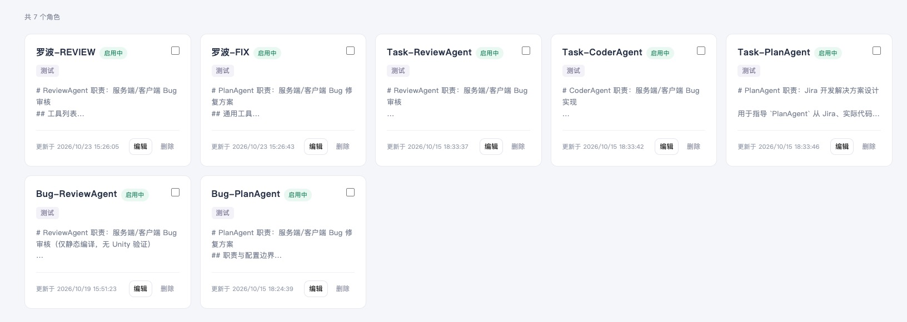

1. 打开「角色管理」，查看已有角色的名称、职责和启用状态。
2. 找到合适的角色，点击「编辑」检查职责内容；没有合适角色时，新建角色。
3. 在职责中写清楚工作范围、执行要求和需要交付的结果，保存后确认角色已启用。

列表里只显示部分职责，使用前最好点开看完整内容。比如审核是否需要实际运行验证，要在职责或步骤要求里写清楚。

## 二 配置 SOP 工作流程

SOP 用来安排任务的执行顺序。先把流程搭好，再检查每一步的设置。

### 1 设置流程和执行顺序

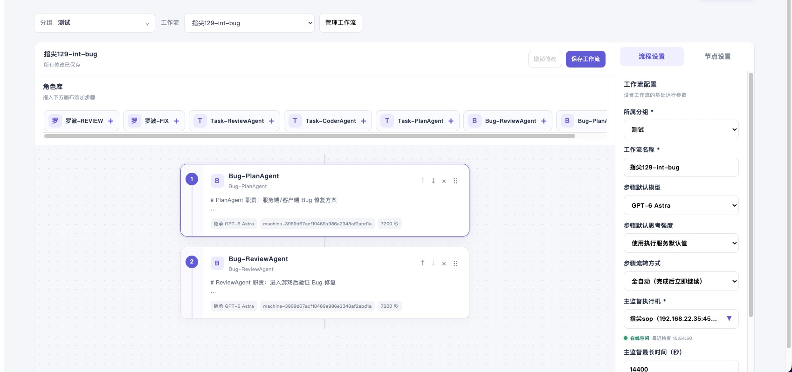

1. 打开「SOP 工作流」，选择已有工作流，或点击「新建 SOP」。
2. 在「流程设置」中确认所属分组、工作流名称、步骤默认模型和主监督执行机。
3. 从角色库拖入需要的角色，组成任务步骤。可调整步骤顺序，确认先做什么、后做什么。
4. 选择「步骤流转方式」，确定使用全自动还是半自动。

图中安排了两个步骤：先处理方案相关工作，再审核。主监督负责安排流程，具体工作由每一步选择的执行机完成。

### 2 选择全自动或半自动

| 对比项 | 全自动 | 半自动 |
| --- | --- | --- |
| 步骤正常完成后 | 自动继续后续步骤 | 查看结果后，点击「进入下一步」 |
| 最后一步完成后 | 自动结束并通知结果 | 查看结果后，点击「确认结束」 |
| 遇到阻碍时 | 可能因阻断结束，需要查看原因 | 保持等待，处理问题后点击「重新执行」，或终止任务 |
| 使用建议 | 要求明确，希望连续执行的任务 | 需要逐步审核、讨论或调整的任务 |

半自动会一直等你确认，聊天回复后仍需点击卡片按钮。任务启动后会沿用当时的设置，中途修改流转方式，要等下次按新配置运行才生效。

### 3 检查每一步的详细设置

点击画布中的步骤，切换到右侧「节点设置」。这里的“节点”就是流程中的一个步骤。

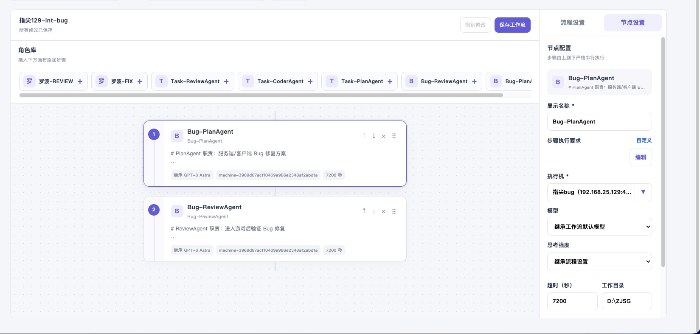

| 设置项 | 怎么填写或检查 |
| --- | --- |
| 显示名称 | 使用容易辨认的名称，方便在钉钉中识别当前步骤 |
| 步骤执行要求 | 点击「编辑」，写清本步骤的工作范围、限制和预期结果 |
| 执行机 | 选择该项目实际使用的机器，确认环境可用 |
| 模型和思考强度 | 无特殊要求时可继承流程设置；需要单独调整时再修改 |
| 超时 | 单位为秒；图中的 7200 秒为 2 小时，按任务需要设置 |
| 工作目录 | 填写执行机上的实际项目目录；留空时使用执行机默认目录 |

保存前再检查一下：

- 图中执行要求显示「自定义」，这一步会使用单独填写的要求。以后修改角色职责时，这里的内容也需要单独检查。
- 工作目录填写执行机上的项目路径。多个步骤需要使用同一批文件时，要确认各自能访问这些文件。
- 模型、目录和超时按自己项目的情况填写。检查完后，点击「保存工作流」。

## 三 设置通知并创建任务

流程保存后，就可以创建任务，填写这次要做的事情，并选择接收通知的群或人员。

### 1 确认钉钉通知对象

打开「钉钉通知对象」，找到需要接收通知的群聊或人员。下面是群聊管理示例。

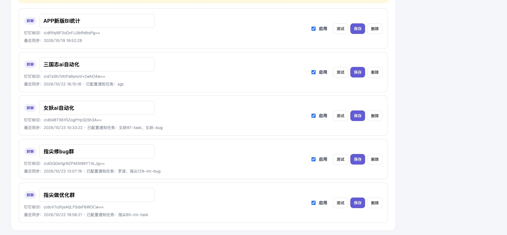

1. 核对群聊名称，确认选择的是本次任务对应的群。
2. 确认通知对象已启用；修改群聊设置后点击「保存」。
3. 首次使用时，可点击「测试」，到对应群聊确认能收到消息。

后面创建任务时，还要选中这个通知对象并勾选推送。一个群可以接收多个任务的通知。

找不到群聊时，先在群里 @ 机器人，再回到页面刷新群聊，请管理员确认并启用。

### 2 关联 Jira 人员与钉钉账号

在「钉钉通知对象」中找到对应人员，点击「Jira 开发人映射」，把他的 Jira 账号和钉钉账号关联起来。

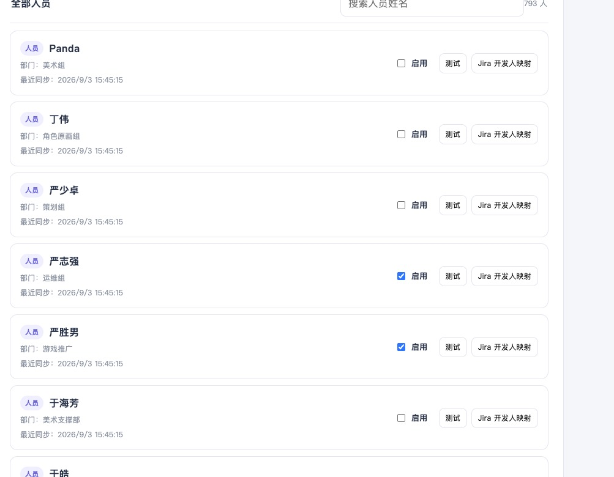

关联前核对一下姓名、部门和 Jira 账号，尤其要留意同名人员。

后续计划接入任务完成通知：Jira 任务完成后，系统就能按这里的对应关系找到相关人员，通过钉钉自动通知他查看结果。这项通知功能目前还未上线。

### 3 新建任务并关联 SOP

打开「任务定义」，点击「新建任务」。

1. 填写任务名称，建议能看出项目和用途。
2. 填写任务目标，说明要处理的问题、范围和预期结果。
3. 选择对应 SOP，确认任务处于启用状态。
4. 选择钉钉通知群聊或人员，并勾选「网页或定时运行后推送钉钉」。
5. 点击「保存任务」，回到任务列表核对信息。

任务目标可以这样写，再补上具体的问题单和要求：

> 处理问题单 XXX-123：先分析原因并给出修复方案，再按步骤完成处理和审核。最后说明改了什么、验证了什么，还有哪些问题需要人工处理。

### 4 启动任务

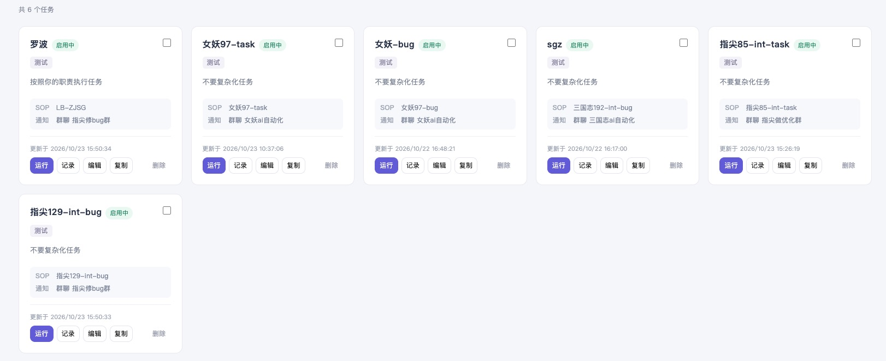

任务卡片会显示名称、目标摘要、关联 SOP 和通知对象。确认无误后，点击「运行」。

- 「编辑」：修改任务配置。
- 「记录」：查看该任务以往的运行记录。
- 「复制」：基于现有任务创建另一份任务配置。

保存后需要点击「运行」才会开始执行。如果同一任务还没结束，先查看进度，不能重复启动。复制出来的任务也要检查目标、SOP 和通知对象，再运行。

### 5 在钉钉中手动触发任务

除了网页上的「运行」按钮，也可以在钉钉中 @ 机器人并发送完整任务名称，启动已经配置好的任务。

1. 打开机器人所在群聊，在输入框中选择 @ 对应机器人。
2. 在后面填写「任务定义」中的完整任务名称。例如，图中发送的是「@sop测试机器人 指尖129-int-bug」。
3. 发送后等待启动回复，核对任务名称，再通过「查看监控」跟进进度。

任务名称可以直接从「任务定义」中复制，避免填成角色或 SOP 的名称。这里启动的是已保存的任务。

从钉钉启动后，进度和结果会发到当前会话，不再另发给任务配置中的通知对象。

## 四 在钉钉查看进度和处理问题

### 1 查看启动通知和任务进度

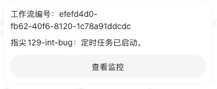

收到启动卡片后，点击「查看监控」就能看到任务进度。图中是定时任务的通知，网页和钉钉手动启动的任务也可以通过监控查看。

收到这条消息后，等待后续执行结果即可。监控页面需要在能访问平台的网络环境下打开。

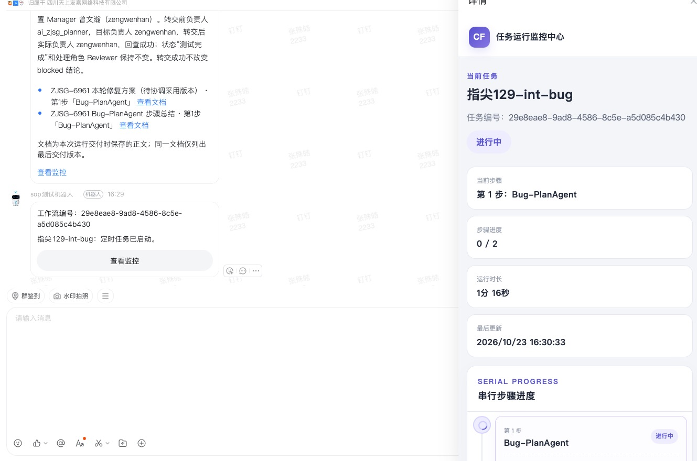

在电脑端钉钉点击「查看监控」，可以像图中这样在右侧打开任务进度，一边看群消息，一边查看任务执行到了哪一步，不用来回切换页面。

右侧会显示当前步骤、已完成步骤数、运行时长和最后更新时间，往下还能查看各步骤的状态。图中任务正在执行第 1 步，进度为「0 / 2」，表示共 2 步，目前还没有步骤完成。

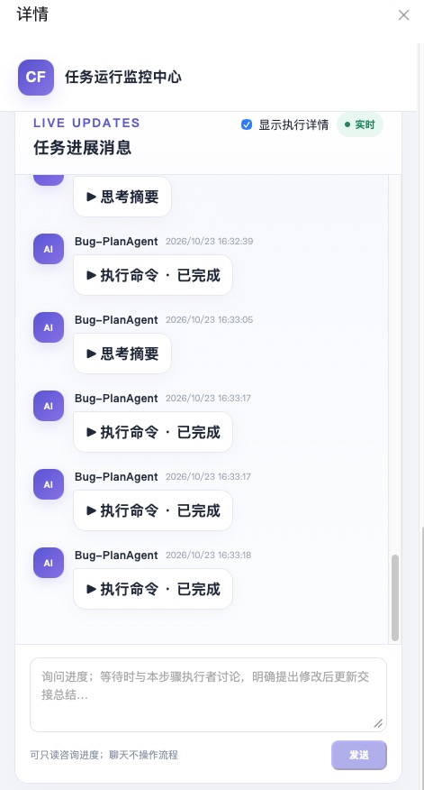

继续往下看，可以找到「任务进展消息」。勾选「显示执行详情」，就能看到执行过程中的消息；点击消息前的小三角，可以展开查看「思考摘要」或「执行命令」的具体内容。

这里的「执行命令 · 已完成」表示这一次操作完成了，整个任务的进度仍要看上方的步骤状态。底部输入框也可以用来询问进度，等待确认时还可以讨论当前步骤的结果；发送消息不会自动进入下一步。

### 2 在群里询问任务状态

想快速了解进度，也可以直接在钉钉里问机器人。

找到要查询的任务通知，使用钉钉的「引用回复」，然后 @ 机器人，输入“进度情况”或“现在执行到哪一步了？”，发送后等机器人回复。

像图中这样引用对应任务的消息，机器人才能知道你问的是哪次运行。如果提示无法识别任务，就复制通知中的工作流编号，按“编号＋问题”的方式重新发送。询问进度不会放行下一步，半自动任务仍需点击卡片上的确认按钮。

### 3 半自动模式下查看结果并确认

每一步完成后，先看结果，再点击最新卡片上的按钮：

| 当前情况 | 操作 |
| --- | --- |
| 中间步骤结果已确认 | 点击「进入下一步」 |
| 最后一步结果已确认 | 点击「确认结束」 |
| 当前步骤遇阻，问题已处理 | 点击「重新执行」，重新执行当前步骤 |
| 决定不再继续任务 | 点击「终止任务」 |

有疑问或需要修改的地方，可以先回复讨论，处理好后再确认。点击「终止任务」只会停止后续执行，已经修改的文件或完成的操作不会撤销。

### 4 遇到问题时先讨论再处理

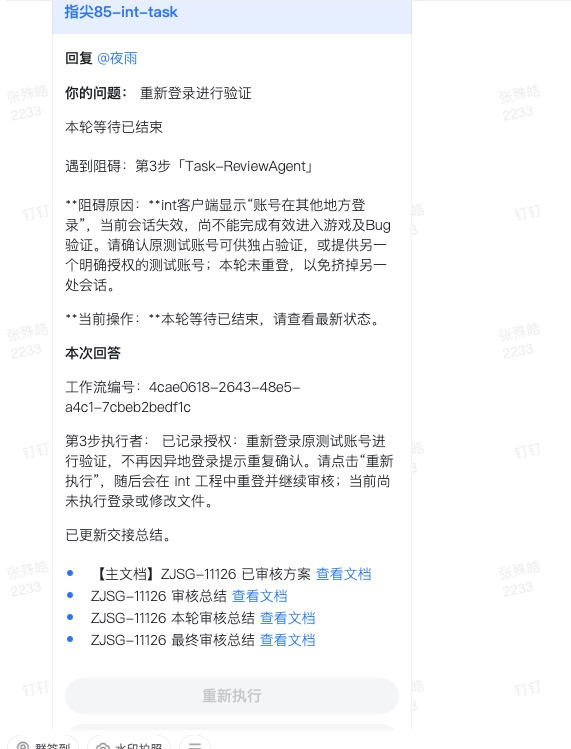

图中因为测试账号登录问题，审核没能完成。遇到类似情况，可以这样处理：

1. 阅读「阻碍原因」，确认缺少什么条件，例如测试账号、验证环境或必要资料。
2. 在钉钉中引用对应任务消息并 @ 机器人，说明问题或补充要求。无法识别引用时，可按提示附上任务通知中的工作流编号。
3. 查看回复。有修改要求就直接写清楚，例如“请按刚才补充的要求修改结果并更新总结”；只是询问原因，不会改动总结。
4. 若当前步骤仍处于遇阻等待，补齐条件后点击最新卡片上的「重新执行」。成功后再检查结果，并按提示确认。

图里这张卡片已经显示「本轮等待已结束」，按钮也变灰了，需要到最新卡片或监控里查看后续情况。回复中的“已记录授权”表示收到了要求，是否完成验证还要看后面的结果。

## 五 查看最终总结和交付文档

任务结束后，先看处理结论，再看有没有遗漏的验证和需要人工接手的事情。

### 1 半自动结束总结

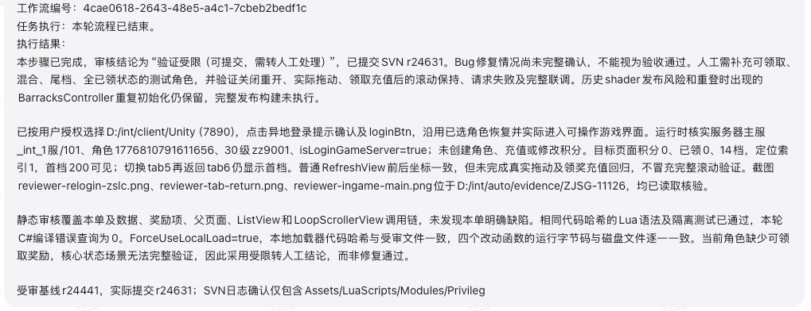

这份总结虽然显示流程已结束，但结论是“验证受限”“需转人工处理”，还有验证工作需要人工接着做。

看总结时，主要检查：

- 已完成的处理和验证范围。
- 未验证的功能及原因。
- 需要人工补充的条件和后续操作。
- 交付文档或结果文件的位置。

### 2 全自动结束卡片

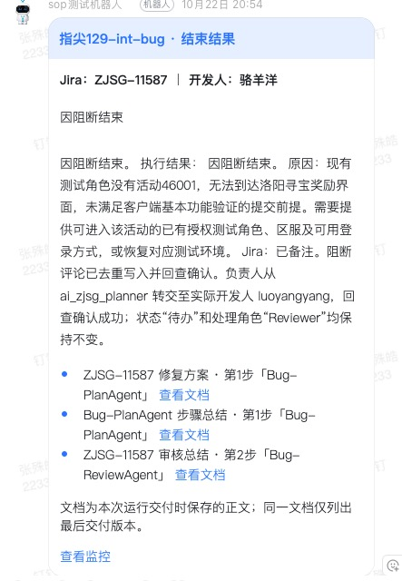

全自动结束卡片会展示本次结果，有交付文档时可点击「查看文档」，也可以点击「查看监控」核对执行过程。

图中这次任务因测试条件不足而结束，需要先按说明补齐条件，再安排后续处理。下方列出了本次交付的文档，同一份文档只展示最后交付的版本。

“结束”只表示本次流程已经停止，任务是否做完、验证是否通过，还要看总结里的结论。

## 六 查看任务运行情况

在配置中心打开「任务运行」，可以看到钉钉手动触发和定时任务的记录。网页启动的任务，在「任务定义」中点击对应任务的「记录」查看。

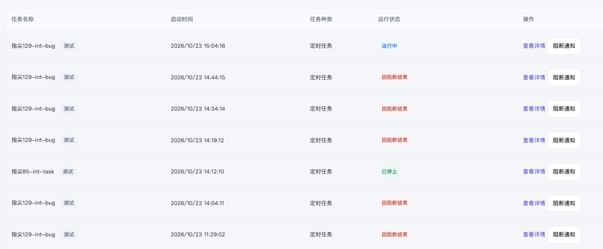

1. 根据「任务名称」找到要查看的任务。同一任务多次运行会产生多条记录，可结合「启动时间」区分。
2. 查看「任务种类」，了解本次运行的启动方式；图中的记录为定时任务。
3. 查看「运行状态」：图中的「运行中」表示任务尚未结束，「因阻断结束」表示需要查看阻碍原因，「已停止」表示该次运行已停止，不代表成功完成。
4. 点击「查看详情」进入对应运行，核对步骤进度和具体结果。需要了解阻断通知情况时，点击该行的「阻断通知」。

同一个任务可能有多次运行记录，查看时先对一下启动时间，页面使用北京时间。半自动等你确认时也会显示「运行中」，点开详情或查看钉钉最新卡片，就能知道当前在等哪一步。

后续会在这里增加 Jira 编号和更详细的统计，方便查找对应的问题单、跟踪处理进度和汇总运行结果。
